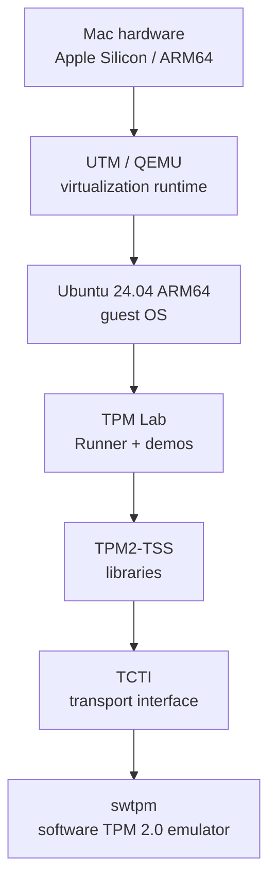
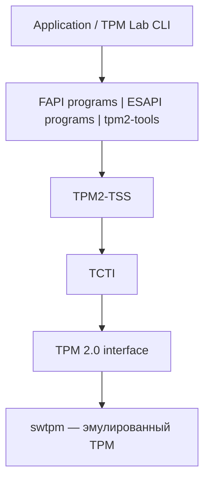
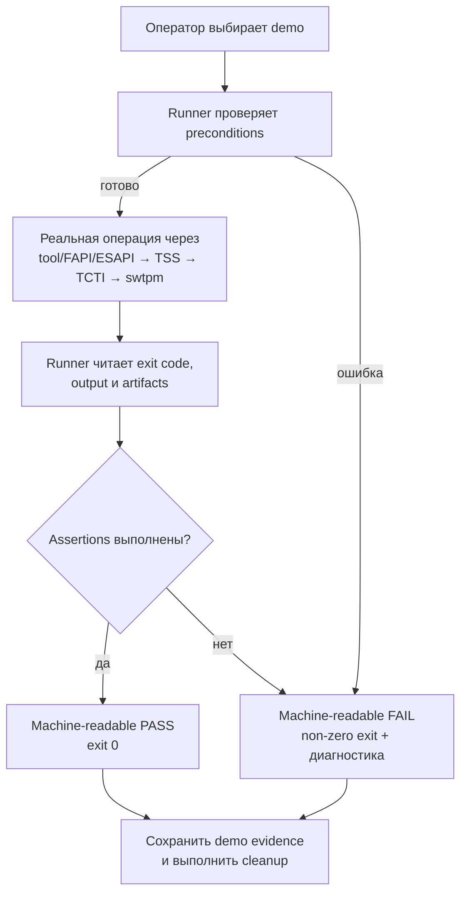

# Архитектура TPM Lab

**Версия:** 0.1  
**Статус:** целевая архитектура; реализация и environment validation запланированы на следующие Sprint

## 1. Deployment architecture



```text
macOS ARM64
  -> UTM/QEMU
    -> Ubuntu ARM64
      -> TPM Lab
        -> TPM2-TSS
          -> TCTI
            -> swtpm
```

Это **physical/project deployment view**: она показывает, где выполняются компоненты. Детали endpoint между TCTI и `swtpm` будут выбраны и проверены при environment setup.

## 2. Logical software stack



Логический вид отвечает не на вопрос «в какой машине?», а на вопрос «через какие abstraction layers проходит операция?». Application не обращается напрямую к TPM state: запрос последовательно преобразуется API/tool, TPM2-TSS и transport layer.

## 3. Ожидаемый финальный demo flow



Для negative scenario, например `Unseal` после изменения PCR, ветка `PASS` разрешена только если:

1. требуемое состояние действительно подготовлено;
2. PCR действительно изменился;
3. вызов `Unseal` реально выполнен;
4. получен ожидаемый policy rejection, а не случайная infrastructure error.

Нельзя печатать заранее заготовленный `PASS` или имитировать успешную/неуспешную TPM operation.

## 4. Компоненты простыми словами

### UTM/QEMU

QEMU предоставляет virtualization/emulation mechanisms для запуска guest machine. UTM — удобный macOS frontend для настройки и управления QEMU-based VM. На Apple Silicon планируется ARM64 guest, чтобы использовать native architecture virtualization и не добавлять обязательную x86 emulation.

### Ubuntu guest

Guest — отдельная Linux operating system, запущенная внутри VM. Именно в Ubuntu 24.04 ARM64 будут установлены TPM clients/libraries и будет выполняться лабораторный код. Guest изолирует учебную Linux environment от macOS и делает инструкции ближе к стандартной TPM tooling ecosystem.

### swtpm

`swtpm` — программа, реализующая интерфейс и поведение TPM 2.0 в software. Она действительно обрабатывает команды, хранит TPM state и возвращает ответы; это не нарисованный mock output. Но вычисления и state контролируются обычной host software environment, поэтому `swtpm` не даёт свойств физически защищённого чипа.

### TPM2-TSS

TPM2-TSS — набор libraries, реализующих TPM Software Stack. Он даёт приложениям стандартизованные API и преобразует API calls в команды TPM. В проекте через него работают `tpm2-tools`, FAPI и ESAPI programs.

### TCTI

TCTI (TPM Command Transmission Interface) — transport abstraction. Он отвечает за отправку сериализованных TPM commands к выбранному TPM endpoint и возврат responses. Благодаря TCTI верхние layers могут работать с разными способами подключения, но конкретная configuration должна соответствовать `swtpm`.

### tpm2-tools

`tpm2-tools` — CLI utilities для типовых TPM 2.0 operations: чтения capabilities/PCR, создания objects, signing и policy operations. Они удобны для первых demo и диагностики, но runner всё равно обязан проверять их exit codes и outputs.

### FAPI

FAPI (Feature API) — высокоуровневый TPM2-TSS API. Он скрывает больше деталей object/session lifecycle и использует profiles/persistent metadata. Это облегчает common workflows, но требует корректной initial configuration и provisioning.

### ESAPI

ESAPI (Enhanced System API) — более низкоуровневый API TPM2-TSS. Он помогает с serialization и resource handling, но приложение явно управляет большим числом TPM concepts: handles, sessions, authorization и последовательностью calls. Поэтому ESAPI полезен для понимания деталей и точного контроля.

## 5. Ответственность layers

- **Runner:** orchestration, preconditions, assertions, status, cleanup.
- **tpm2-tools/FAPI/ESAPI app:** формулировка операции на нужном abstraction level.
- **TPM2-TSS:** API semantics, command preparation и обработка response.
- **TCTI:** transport до TPM endpoint.
- **swtpm:** эмулированное выполнение TPM 2.0 commands и state transitions.
- **UTM/QEMU:** запуск guest и предоставление virtualized devices/connections.

## 6. Границы модели: REAL / EMULATED / NOT MODELED

### REAL

- физическое **Mac hardware**, на котором идёт вычисление;
- реально работающий **virtualization runtime** UTM/QEMU;
- реально загруженная **Linux guest operating system**;
- **actual software execution** runner, `tpm2-tools`, FAPI/ESAPI programs, TPM2-TSS, TCTI и `swtpm`;
- реальные exit codes, data transformations, signatures и policy decisions внутри software model.

«REAL» здесь означает, что software действительно исполняется, а не что каждый компонент является физическим security hardware.

### EMULATED

- **TPM 2.0 implementation via `swtpm`**;
- его registers, objects, command processing и persistent state — программная модель TPM behavior.

Эмуляция пригодна для проверки command semantics, API integration и demo logic. Она не превращается в hardware TPM только потому, что подключена к VM как virtual TPM.

### NOT MODELED

- physical tamper resistance;
- side-channel resistance;
- physical chip attack resistance;
- независимая аппаратная trust boundary от владельца host;
- сертификационные свойства конкретного commercial TPM.

## 7. Security и trust boundaries

Владелец host потенциально контролирует VM, `swtpm` process и его state files. Поэтому sealed data в этой лаборатории защищается **логикой эмулированной TPM policy в рамках эксперимента**, но не считается защищённой от привилегированного физического/host attacker так, как могла бы защищаться сертифицированным hardware TPM.

Лабораторные secrets должны быть тестовыми. Ни одно demo не должно использовать production credentials.

## 8. Planned interfaces

- Operator → Runner: CLI.
- Runner → `tpm2-tools`: subprocess + arguments + exit codes.
- Runner → FAPI/ESAPI apps: versioned CLI/data contract.
- Apps/tools → TPM2-TSS: library API.
- TPM2-TSS → TCTI: TCTI interface/configuration.
- TCTI → `swtpm`: validated transport endpoint.
- Runner → evidence: structured status и sanitized logs.

Точный TCTI и transport являются открытым architecture detail до практической проверки UTM/QEMU integration.

## 9. Architecture evolution

- **Stage 1 (недели 1–6):** проверить deployment assumptions, зафиксировать versions/TCTI и получить defensible architecture.
- **Stage 2 (недели 7–12):** реализовать Runner и Demo 1–4, добавить tests и reset/re-run.
- **Stage 3 (недели 13–17):** добавить FAPI/ESAPI comparison, hardening и финальный demo.

Любое изменение границ или замена `swtpm`/TCTI оформляется Architecture Decision Record и отражается в requirements traceability.
